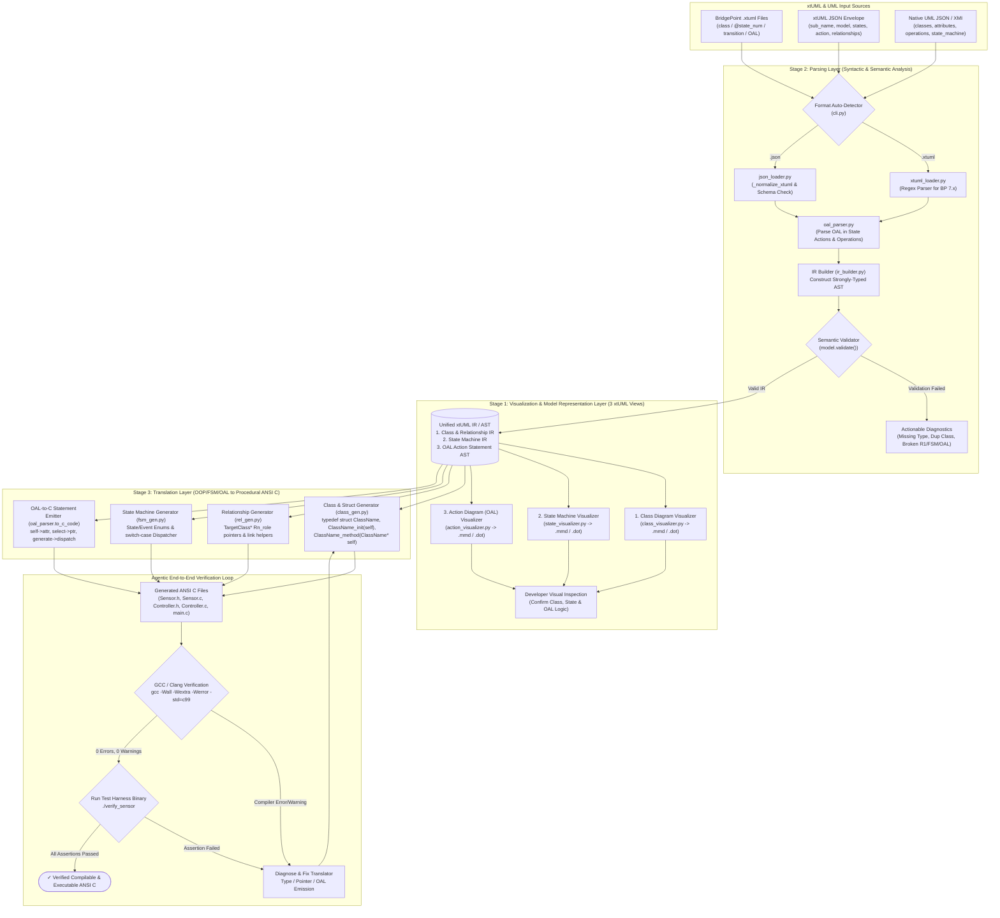
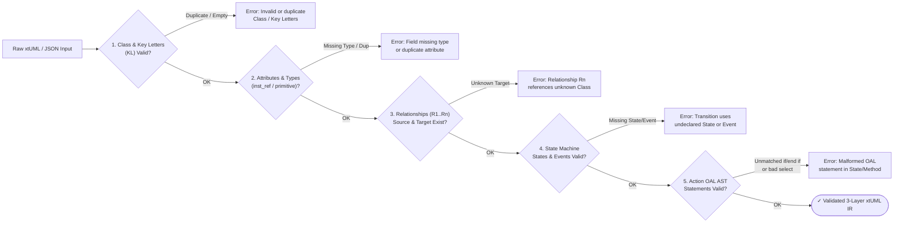
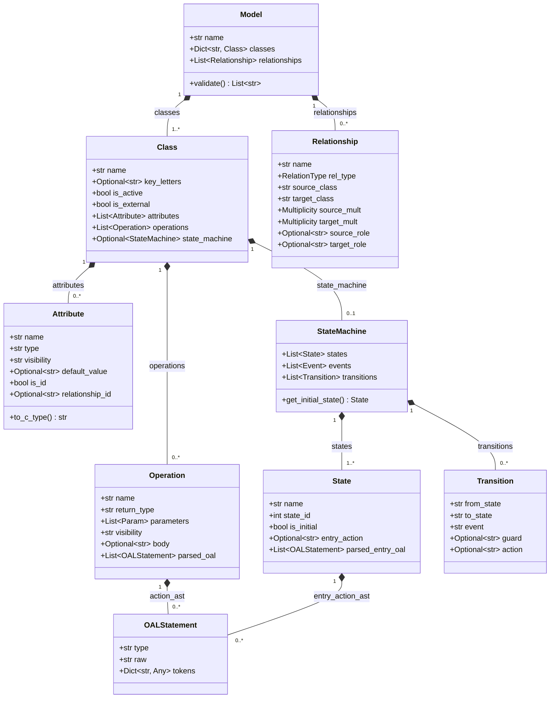
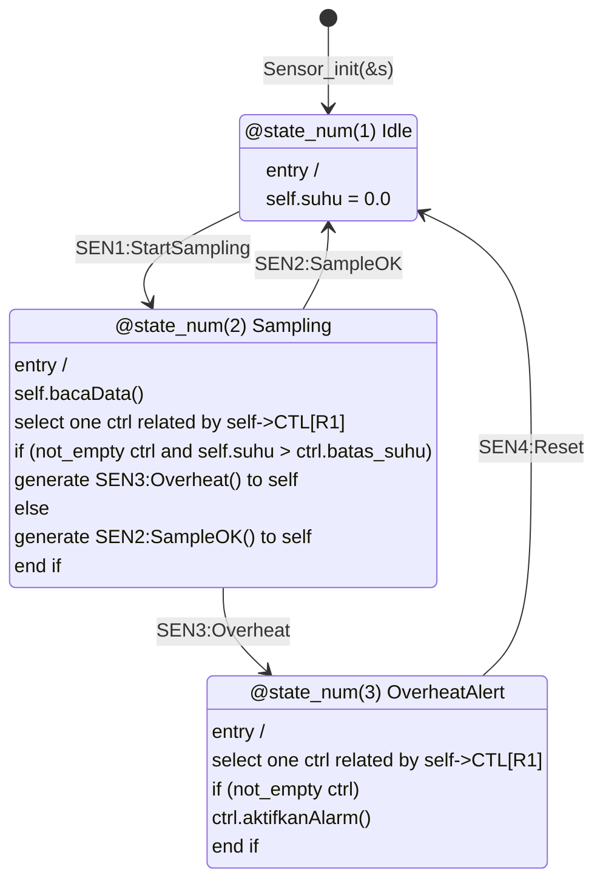
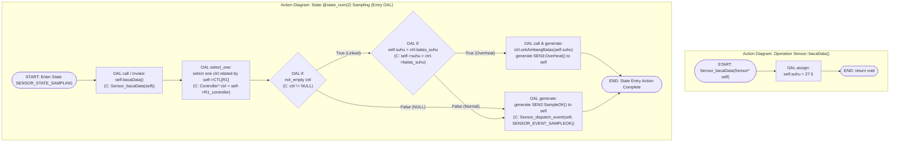
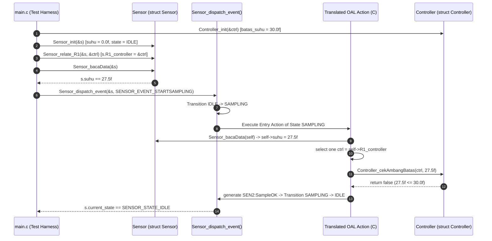

# ARCHITECTURE PLAN: Model-Driven Architecture (MDA) & Automatic Code Generation Pipeline (`xtUML / UML-to-C Compiler`)

> **Role & Objective:** Dokumen arsitektur dan spesifikasi implementasi tingkat *Principal Compiler Engineer & Systems Architect* untuk merancang, mengimplementasikan, dan memverifikasi pipeline **Model-Driven Architecture (MDA) / Automatic Code Generation** pada proyek **UML-to-C Compiler** berbasis **xtUML (Executable & Translatable UML)** yang mencakup tiga pilar visualisasi model: **Class Diagram**, **State Machine Diagram**, dan **Action Diagram (OAL / Object Action Language)**.

---

## Daftar Isi
1. [Hasil Eksplorasi Workspace & Tiga Pilar xtUML](#1-hasil-eksplorasi-workspace--tiga-pilar-xtuml)
2. [ASCII Wireframes (Web Studio 3-View xtUML, CLI Visualizer, & Memory Mapping)](#2-ascii-wireframes-web-studio-3-view-xtuml-cli-visualizer--memory-mapping)
3. [Flowchart & Mermaid Diagrams (Pipeline & 3 Diagram Visualisasi xtUML)](#3-flowchart--mermaid-diagrams-pipeline--3-diagram-visualisasi-xtuml)
4. [Konsep Inti Arsitektur: 3-Stage xtUML-to-C Compiler Pipeline](#4-konsep-inti-arsitektur-3-stage-xtuml-to-c-compiler-pipeline)
5. [Aturan Pemetaan Wajib xtUML (Class, State, Action/OAL) ke Procedural ANSI C](#5-aturan-pemetaan-wajib-xtuml-class-state-actionoal-ke-procedural-ansi-c)
6. [End-to-End Verification Loop (Studi Kasus xtUML: `Sensor` & `Controller`)](#6-end-to-end-verification-loop-studi-kasus-xtuml-sensor--controller)
7. [Agentic Execution Workflow Checklist](#7-agentic-execution-workflow-checklist)

---

## 1. Hasil Eksplorasi Workspace & Tiga Pilar xtUML

Berdasarkan inspeksi repositori `uml-to-c-compiler`, proyek ini dirancang untuk memproses model **xtUML (BridgePoint `.xtuml` & xtUML JSON envelope seperti `examples/xtumlVM.json`)** maupun **JSON UML Native** menggunakan **Python 3 (stdlib-only)** di sisi CLI dan **Vanilla ES6 JavaScript** di sisi Web Studio.

Berbeda dengan UML statis biasa, **xtUML (Executable & Translatable UML)** merepresentasikan sistem secara lengkap melalui **3 Diagram yang saling terhubung** di dalam *Intermediate Representation (IR)*:

1. **xtUML Class Diagram (Struktur & Informasi Komponen):**
   - Mendefinisikan `Class` beserta **Key Letters (`KL`)** (mis. `SEN` untuk `Sensor`, `CTL` untuk `Controller`), **External Entities (`is_external: true`)** untuk bridge hardware/service, atribut (`naming_attribute {I}`, `descriptive_attribute`, dan `referential_attribute {Rn} inst_ref<Target>`), `operations`, serta relasi bernomor (`R1`, `R2`, dst.).
2. **xtUML State Machine Diagram (Siklus Hidup & Perilaku Event-Driven):**
   - Setiap *Active Class* memiliki *Instance State Machine* (`@state_num(1..N)`), daftar *Events* bernomor (`@event_num(1..M)`, mis. `SEN1:MulaiBaca`, `SEN2:DataSiap`), dan *State Transition Matrix* (`from_state --[Event]--> to_state`).
3. **xtUML Action Diagram / OAL Flow (Logika Eksekusi Prosedural di dalam State & Operation):**
   - Setiap *State* (pada *entry action*) dan setiap *Operation* (pada *method body*) berisi kode **OAL (Object Action Language)** yang diparsing oleh `compiler/parser/oal_parser.py` menjadi AST instruksi (`create object instance`, `select one/any related by self->KL[Rn]`, `relate/unrelate across Rn`, `assign self.attr = val`, `if / elif / else / end if`, `while`, `for each`, `Bridge::call()`, dan `generate EVENT to target`).
   - **Action Diagram** memvisualisasikan AST OAL tersebut sebagai diagram alir eksekusi (*Control-Flow & Data-Access Graph*) sehingga developer dapat memverifikasi logika internal setiap *state* dan *method* sebelum ditranslasikan ke fungsi bahasa C.

### Struktur Direktori Target & Eksisting

```text
uml-to-c-compiler/
├── ARCHITECTURE_PLAN.md           # Dokumen arsitektur MDA xtUML (3-Diagram Visualizer + C Translator)
├── README.md                      # Dokumentasi utama proyek
├── USER_GUIDE.md                  # Panduan pengguna
├── VERIFICATION_REPORT.md         # Laporan verifikasi kompilasi
├── compiler/                      # Core Python Compiler Package (stdlib-only)
│   ├── __init__.py
│   ├── cli.py                     # CLI terintegrasi (input: .xtuml, JSON xtUML envelope, JSON native)
│   ├── parser/                    # [STAGE 2] Syntactic & Semantic Parsing Layer
│   │   ├── __init__.py
│   │   ├── xtuml_loader.py        # Parser file/workspace BridgePoint (.xtuml) -> Class + State + OAL
│   │   ├── json_loader.py         # Parser JSON native & normalizer xtUML VM JSON (_normalize_xtuml)
│   │   └── oal_parser.py          # Parser OAL (Object Action Language) -> List[OALStatement] AST
│   ├── ir/                        # [STAGE 1 & 2] Strongly-Typed Intermediate Representation (AST)
│   │   ├── __init__.py
│   │   ├── metamodel.py           # Model, Class, Attribute, Operation, Relationship, StateMachine, OAL
│   │   └── ir_builder.py          # IR Builder & Semantic Validator (Class + FSM + OAL consistency)
│   ├── visualizer/                # [STAGE 1] 3-View xtUML Visualization & Verification Layer
│   │   ├── __init__.py
│   │   ├── class_visualizer.py    # Generator Mermaid/DOT untuk xtUML Class Diagram (KL, R1..Rn, Attrs)
│   │   ├── state_visualizer.py    # Generator Mermaid/DOT untuk xtUML State Machine Diagram (States & Events)
│   │   └── action_visualizer.py   # Generator Mermaid/DOT untuk xtUML Action Diagram (OAL Control Flow)
│   └── codegen/ (translator/)     # [STAGE 3] Translation Layer (xtUML OOP/FSM/OAL -> Procedural ANSI C)
│       ├── __init__.py
│       ├── c_writer.py            # Formatter kode C99 / ANSI C
│       ├── class_gen.py           # Emitter struct, ClassName_init, ClassName_create, getters/setters, methods
│       ├── fsm_gen.py             # Emitter State/Event enums & switch-case event dispatcher + entry actions
│       └── rel_gen.py             # Emitter pointer relasi R1..Rn (relate / unrelate / select related)
├── runtime_c/                     # Embedded C Runtime Headers (Static Pool, Event Queue, Types)
│   ├── uml_types.h
│   ├── uml_pool.h
│   ├── uml_event_queue.h
│   └── uml_port.h
├── web/                           # Web-based xtUML Compiler & 3-Diagram Visual Verification Studio
│   ├── index.html
│   ├── style.css
│   ├── xtuml_parser.js
│   ├── compiler.js
│   ├── app.js
│   └── tests.js
├── examples/                      # Contoh model (.json / .xtuml): xtumlVM.json, door_model.json, sensor_xtuml.json
├── tests/                         # Unit & End-to-End GCC Self-Testing Suite
│   └── test_compiler.py
└── output/                        # Hasil generate (*.h, *.c, main.c, model_class.mmd, model_state.mmd, model_action.mmd)
```

---

## 2. ASCII Wireframes (Web Studio 3-View xtUML, CLI Visualizer, & Memory Mapping)

### 2.1. ASCII Wireframe: Web Compiler Studio dengan 3 Tab Visualisasi xtUML (`Class`, `State`, `Action`)

Wireframe antarmuka Web/IDE yang menampilkan input model `.xtuml` / JSON di panel kiri, **Visualisasi 3-Diagram xtUML (Stage 1)** di panel tengah dengan *tab switcher* (`[1. Class Diagram]`, `[2. State Diagram]`, `[3. Action (OAL) Diagram]`), serta hasil kode **ANSI C (Stage 3)** di panel kanan:

```text
+============================================================================================================+
|  ⚡ xtUML-to-C MDA Compiler Studio          [📁 Load .xtuml/JSON] [🔍 Verify 3-Diagrams] [▶ Compile] [💾]  |
+============================================================================================================+
| XTUML INPUT (.xtuml / JSON)     | STAGE 1: XTUML VISUAL VERIFICATION        | STAGE 3: ANSI C CODEGEN      |
| [Source: sensor_xtuml.json]     | [1.Class] [2.State FSM] [*3.Action OAL*]  | [File: Sensor.c      v] [📋] |
+---------------------------------+-------------------------------------------+------------------------------+
|  1 | {                          |  Action Diagram: Sensor::State[2:Reading] |  1 | #include "Sensor.h"     |
|  2 |  "type": "subsystem",      |  & Operation Sensor::bacaData()           |  2 |                         |
|  3 |  "sub_name": "ThermalSys", |  +-------------------------------------+  |  3 | void Sensor_init(       |
|  4 |  "model": [{               |  |     ([START: Entry State Reading])  |  |  4 |     Sensor* self) {     |
|  5 |   "type": "class",         |  +------------------+------------------+  |  5 |   if (!self) return;    |
|  6 |   "class_name": "Sensor",  |                     |                     |  6 |   self->suhu = 0.0f;    |
|  7 |   "KL": "SEN",             |                     v                     |  7 |   self->R1_ctrl = NULL; |
|  8 |   "attributes": [          |  +-------------------------------------+  |  8 |   self->current_state = |
|  9 |    {"attribute_name":      |  | [OAL: assign / call]                |  |  9 |     SENSOR_STATE_IDLE;  |
| 10 |     "suhu",                |  | self.bacaData() -> self.suhu = 27.5 |  | 10 | }                       |
| 11 |     "data_type": "real"}   |  +------------------+------------------+  | 11 |                         |
| 12 |   ],                       |                     |                     | 12 | void Sensor_bacaData(   |
| 13 |   "operations": [          |                     v                     | 13 |     Sensor* self) {     |
| 14 |    "bacaData()"            |  +-------------------------------------+  | 14 |   if (!self) return;    |
| 15 |   ],                       |  | [OAL: select_one across R1]         |  | 15 |   self->suhu = 27.5f;   |
| 16 |   "states": [{             |  | select one ctrl related by          |  | 16 | }                       |
| 17 |    "state_id": "2",        |  |   self->CTL[R1];                    |  | 17 |                         |
| 18 |    "state_name": "Reading",|  +------------------+------------------+  | 18 | void Sensor_dispatch(   |
| 19 |    "state_event": [        |                     |                     | 19 |     Sensor* self,       |
| 20 |     "SampleTick"],         |                     v                     | 20 |     Sensor_Event evt) { |
| 21 |    "next_state": "Idle",   |            /-----------------\            | 21 |   /* Switch FSM &       |
| 22 |    "action":               |           /  if (not_empty    \           | 22 |      OAL Entry Actions*/|
| 23 |     "self.suhu = 27.5;\n   |           \   ctrl & suhu>30) /           | 23 |   ...                   |
| 24 |      select one ctrl       |            \-----------------/            | 24 | }                       |
| 25 |      related by            |              /Yes          \No            | 25 |                         |
| 26 |      self->CTL[R1];..."    |             v               v             | 26 |                         |
| 27 |   }]                       |  +-------------------+ +---------------+  | 27 |                         |
| 28 |  }]                        |  | generate CTL1:    | | generate SEN2:|  | 28 |                         |
| 29 | }                          |  | Overheat to ctrl  | | ReadOK to self|  | 29 |                         |
| 30 |                            |  +-------------------+ +---------------+  | 30 |                         |
+---------------------------------+-------------------------------------------+------------------------------+
| DIAGNOSTIC & VERIFICATION CONSOLE                                                                          |
| > [STAGE 2 - PARSER]  xtUML Parsed: 2 Classes (SEN, CTL), 1 Rel (R1), 3 States, 6 OAL Statements           |
| > [STAGE 1 - VISUAL]  Rendered 3 xtUML Diagrams: Class (.mmd), State Machine (.mmd), Action OAL CFG (.mmd) |
| > [STAGE 3 - CODEGEN] Translated to Sensor.h, Sensor.c, Controller.h, Controller.c, main.c                 |
| > [SELF-TEST - GCC]   gcc -Wall -Wextra -Werror -std=c99 -> 0 warnings, 0 errors [EXECUTION PASSED]        |
+============================================================================================================+
```

---

### 2.2. ASCII Wireframe: Output Terminal untuk 3 Diagram Visualisasi xtUML (Class, State, Action)

Berikut adalah tampilan wireframe terminal ketika fitur visualisasi CLI dijalankan (`python -m compiler.cli examples/sensor_xtuml.json --visualize`):

```text
+============================================================================================================+
|                         STAGE 1: XTUML 3-VIEW VISUAL VERIFICATION DUMP                                     |
+============================================================================================================+
|                                                                                                            |
|  [VIEW 1/3] XTUML CLASS DIAGRAM (Information Model & Numbered Associations)                                |
|  --------------------------------------------------------------------------                                |
|   +------------------------------------+            R1             +------------------------------------+  |
|   |       <<Class, KL: SEN>>           |      (melaporkan ke)      |       <<Class, KL: CTL>>           |  |
|   |              Sensor                | 0..* -----------------> 1 |            Controller              |  |
|   +------------------------------------+                           +------------------------------------+  |
|   | - id_sensor : int {I}              |                           | + batas_suhu : float = 30.0        |  |
|   | - suhu : float = 0.0               |                           | - alarm_aktif : bool = false       |  |
|   | - R1_controller : inst_ref<CTL>    |                           +------------------------------------+  |
|   +------------------------------------+                           | + Controller_init(self) : void     |  |
|   | + Sensor_init(self) : void         |                           | + evaluasiSuhu(suhu: float) : bool |  |
|   | + bacaData() : void                |                           +------------------------------------+  |
|   +------------------------------------+                                                                   |
|                                                                                                            |
|  [VIEW 2/3] XTUML STATE MACHINE DIAGRAM (Active Class Lifecycle: Sensor)                                   |
|  -----------------------------------------------------------------------                                   |
|                                                                                                            |
|     (*) ---> +-----------------------------------+    SEN1:MulaiBaca     +------------------------------+  |
|              | @state_num(1) Idle                | --------------------> | @state_num(2) Reading        |  |
|              |-----------------------------------|                       |------------------------------|  |
|              | entry /                           | <-------------------- | entry /                      |  |
|              |   // Standby menunggu trigger     |    SEN2:BacaSelesai   |   self.bacaData();           |  |
|              +-----------------------------------+                       |   select one ctrl related by |  |
|                                ^                                         |     self->CTL[R1]; ...       |  |
|                                | SEN4:Reset                              +------------------------------+  |
|                                |                                                        |                  |
|              +-----------------------------------+                                      | SEN3:Overheat    |
|              | @state_num(3) Alert               | <------------------------------------+                  |
|              |-----------------------------------|                                                         |
|              | entry /                           |                                                         |
|              |   generate CTL1:TriggerAlarm      |                                                         |
|              |     to self->CTL[R1];             |                                                         |
|              +-----------------------------------+                                                         |
|                                                                                                            |
|  [VIEW 3/3] XTUML ACTION DIAGRAM (Parsed OAL AST Control-Flow & Data-Access Graph)                         |
|  ---------------------------------------------------------------------------------                         |
|   Context: Sensor::State[2: Reading] + Operation Sensor::bacaData()                                        |
|                                                                                                            |
|   [START] --> [OAL assign: self.suhu = 27.5]                                                               |
|                      |                                                                                     |
|                      v                                                                                     |
|               [OAL select_one: ctrl = self->CTL[R1]]                                                       |
|                      |                                                                                     |
|                      v                                                                                     |
|               <OAL if: not_empty ctrl> --(False)--> [OAL generate: SEN2:BacaSelesai to self] --> [END]     |
|                      | (True)                                                                              |
|                      v                                                                                     |
|               <OAL if: self.suhu > ctrl.batas_suhu>                                                        |
|                 | (True)                         | (False)                                                 |
|                 v                                v                                                         |
|     [OAL generate: SEN3:Overheat]    [OAL generate: SEN2:BacaSelesai]                                      |
|                 |                                |                                                         |
|                 +---------------+----------------+                                                         |
|                                 v                                                                          |
|                               [END]                                                                        |
+============================================================================================================+
```

---

### 2.3. ASCII Wireframe: Pemetaan 3 Diagram xtUML ke Memori & Konstruksi Procedural ANSI C

```text
  [ 3 DIAGRAM XTUML (MODEL VIEW) ]                   [ KONSTRUKSI PROCEDURAL ANSI C (CODEGEN VIEW) ]

  1. xtUML CLASS DIAGRAM                             1. HEADER & STRUCT MEMORY LAYOUT (Sensor.h)
  +-------------------------------+                  +----------------------------------------------------+
  | Sensor <<KL: SEN>>            |                  | typedef struct Sensor {                            |
  | - suhu : float                |  =============>  |     float suhu;               /* Attribute      */ |
  | - R1_ctrl : inst_ref<CTL>     |   Struct &       |     Controller* R1_ctrl;      /* Assoc R1 Ptr   */ |
  | + bacaData() : void           |   Context Ptr    |     Sensor_State current_state;/* FSM State Reg */ |
  +-------------------------------+                  | } Sensor;                                          |
                                                     | void Sensor_init(Sensor* self);                    |
                                                     | void Sensor_bacaData(Sensor* self);                |
                                                     +----------------------------------------------------+

  2. xtUML STATE MACHINE DIAGRAM                     2. FSM ENUM & EVENT DISPATCHER (Sensor.h / Sensor.c)
  +-------------------------------+                  +----------------------------------------------------+
  | [1:Idle] --SEN1--> [2:Reading]|  =============>  | typedef enum { SENSOR_STATE_IDLE = 0,              |
  | [2:Reading] --SEN2--> [1:Idle]|   State/Event    |                SENSOR_STATE_READING = 1 } ...;     |
  +-------------------------------+   Enums &        | void Sensor_dispatch_event(Sensor* self,           |
                                      2D Switch      |                            Sensor_Event evt) {     |
                                                     |     switch (self->current_state) { ... }           |
                                                     | }                                                  |
                                                     +----------------------------------------------------+

  3. xtUML ACTION DIAGRAM (OAL)                      3. PROCEDURAL C BODY & RUNTIME CALLS (Sensor.c)
  +-------------------------------+                  +----------------------------------------------------+
  | assign self.suhu = 27.5;      |                  | self->suhu = 27.5f;                                |
  | select one c related by       |  =============>  | Controller* c = self->R1_ctrl;                     |
  |   self->CTL[R1];              |   OAL-to-C       | if (c != NULL) {                                   |
  | if (not_empty c)              |   Statement      |     if (self->suhu > c->batas_suhu) {              |
  |   if (self.suhu > c.batas)    |   Translation    |         Sensor_dispatch_event(self,                |
  |     generate SEN3 to self;    |                  |             SENSOR_EVENT_OVERHEAT);                |
  |   end if;                     |                  |     }                                              |
  | end if;                       |                  | }                                                  |
  +-------------------------------+                  +----------------------------------------------------+
```

---

## 3. Flowchart & Mermaid Diagrams (Pipeline & 3 Diagram Visualisasi xtUML)

### 3.1. End-to-End 3-Stage xtUML-to-C MDA Compiler Pipeline Flowchart

Flowchart arsitektur utama yang menunjukkan bagaimana input `.xtuml` / JSON xtUML diparsing menjadi 3 komponen IR (**Class IR**, **State Machine IR**, **OAL Action AST**), divisualisasikan menjadi **3 Diagram xtUML**, lalu ditranslasikan menjadi kode **ANSI C** dan diverifikasi dengan **GCC**:



---

### 3.2. Flowchart Detail Stage 2: Validasi Sintaksis & Semantik untuk Class, State, dan OAL Action



---

### 3.3. Mermaid Class Diagram: Metamodel IR yang Mencakup Class, State Machine, dan OAL Action AST

Diagram struktur data internal (`compiler/ir/metamodel.py` + `compiler/parser/oal_parser.py`) yang menyimpan ketiga aspek model xtUML:



---

### 3.4. Visualisasi Stage 1 (Diagram 1/3): xtUML Class Diagram (`class_visualizer.py`)

Diagram pertama yang dihasilkan oleh **Stage 1 Visualizer** dari IR xtUML adalah **Class Diagram** lengkap dengan *Key Letters (`KL`)*, *Naming Attribute (`{I}`)*, *Referential Attribute (`{R1}`)*, *External Entity*, dan *Method Signatures*:

```mermaid
classDiagram
    class Sensor {
        <<Active Class | KL: SEN>>
        -int id_sensor
        -float suhu
        -Controller* R1_controller
        +Sensor_init(Sensor* self) void
        +bacaData() void
        +kalibrasi(float offset) void
    }

    class Controller {
        <<Active Class | KL: CTL>>
        -int id_ctrl
        +float batas_suhu
        +bool alarm_aktif
        +Controller_init(Controller* self) void
        +cekAmbangBatas(float suhu_ukur) bool
        +aktifkanAlarm() void
    }

    class HardwareADC {
        <<External Entity | KL: HW>>
        +readRawTemperature() float
    }

    Sensor "0..*" --> "1" Controller : R1 (dimonitor oleh)
    Sensor ..> HardwareADC : Bridge Call (HW::readRawTemperature)
```

---

### 3.5. Visualisasi Stage 1 (Diagram 2/3): xtUML State Machine Diagram (`state_visualizer.py`)

Diagram kedua yang dihasilkan oleh **Stage 1 Visualizer** dari IR xtUML adalah **State Machine Diagram** yang memperlihatkan *State Number (`@state_num`)*, *Event Transisi (`@event_num`)*, serta ringkasan kode **OAL** di dalam setiap *State*:



---

### 3.6. Visualisasi Stage 1 (Diagram 3/3): xtUML Action Diagram / OAL Flowchart (`action_visualizer.py`)

Diagram ketiga yang dihasilkan oleh **Stage 1 Visualizer** adalah **xtUML Action Diagram**, yaitu visualisasi *Control-Flow & Data-Access Graph* dari statement **OAL (Object Action Language)** di dalam *Operation* (`Sensor::bacaData()`) dan *State Entry Action* (`Sensor::State[2: Sampling]`):



---

### 3.7. Mermaid Sequence Diagram: Eksekusi Runtime Hasil Translasi (Class + FSM + OAL Action)



---

## 4. Konsep Inti Arsitektur: 3-Stage xtUML-to-C Compiler Pipeline

### Stage 1: Visualization & Model Representation Layer (`compiler/visualizer/` & `compiler/ir/`)
- **Goal:** Menghadirkan alur kerja *visual-first* yang mengekstrak dan memvisualisasikan ketiga diagram inti dari model **xtUML** sebelum maupun sesudah kode C di-generate.
- **Tiga Output Visualisasi Verifikasi (`compiler/visualizer/`):**
  1. **Class Diagram Output (`class_visualizer.py`):** Menghasilkan diagram Mermaid `classDiagram` dan Graphviz `.dot` yang menampilkan seluruh `Class`, `KL` (*Key Letters*), `Attribute` (beserta tipe C dan penanda `{I}` / `{Rn}`), `Operation`, dan garis relasi `R1..Rn`.
  2. **State Machine Diagram Output (`state_visualizer.py`):** Menghasilkan diagram Mermaid `stateDiagram-v2` untuk setiap kelas aktif yang memiliki `StateMachine`, lengkap dengan state awal `[*]`, nomor state `@state_num`, event pemicu transisi, dan cuplikan *entry action* OAL.
  3. **Action Diagram Output (`action_visualizer.py`):** Mengonversi hasil parse `OALParser` (`List[OALStatement]`) pada setiap *State Entry Action* dan *Operation Body* menjadi diagram alir Mermaid `flowchart TD` yang memvisualisasikan percabangan `if/else`, perulangan `while/for each`, navigasi relasi `select one/any related by`, manipulasi objek `create/delete/relate/unrelate`, serta pengiriman sinyal `generate EVENT to target`.

### Stage 2: Parsing Layer — Syntactic & Semantic Analysis (`compiler/parser/`)
- **Goal:** Membaca file ekspor model xtUML/UML (`.xtuml` BridgePoint maupun `.json`), melakukan validasi sintaksis dan semantik yang ketat, lalu membangun **Intermediate Representation (IR) / AST** bertipe kuat.
- **Komponen Parser:**
  - `xtuml_loader.py`: Mengekstrak `package`, `class ... is ... end class;`, `@key_letters`, `@state_num`, `@event_num`, `transition`, dan blok OAL dari file `.xtuml` BridgePoint.
  - `json_loader.py`: Mendukung format JSON UML Native sekaligus menormalisasi format JSON xtUML VM (`_normalize_xtuml` untuk `sub_name`, `model`, `KL`, `inst_ref<Class>`, `states`, `action`, `events`, `relationships`).
  - `oal_parser.py`: Mem-parsing teks OAL menjadi daftar `OALStatement(type, raw, tokens)` yang siap divisualisasikan menjadi **Action Diagram** (Stage 1) dan ditranslasikan menjadi **statement C** (Stage 3).
- **Contoh Referensi Ekstraksi AST (`Sensor`):**
  Ketika mem-parsing model xtUML dengan kelas `Sensor` (`KL="SEN"`), atribut `suhu` (`float`/`real`), dan metode `bacaData()`, parser mengekstrak:
  ```python
  Entity      : Class(name="Sensor", key_letters="SEN", is_active=True)
  Attribute   : Attribute(name="suhu", type="float", visibility="private", default_value="0.0f")
  Method      : Operation(name="bacaData", return_type="void", parameters=[], body="self.suhu = 27.5f;")
  StateMachine: StateMachine(states=[State("Idle", 0), State("Sampling", 1)], events=[Event("StartSampling", 1)])
  Action AST  : [OALStatement(type="assign", raw="self.suhu = 27.5f", tokens={"target": "self", "attr": "suhu", "value": "27.5f"})]
  ```

### Stage 3: Translation Layer — OOP, FSM & OAL to Procedural ANSI C (`compiler/codegen/`)
- **Goal:** Mentranslasikan ketiga komponen IR xtUML (Class IR, State Machine IR, dan OAL Action AST) menjadi file header (`.h`) dan file implementasi (`.c`) **ANSI C / ISO C99** yang bersih, modular, dan bebas dari *compiler warning*.

---

## 5. Aturan Pemetaan Wajib xtUML (Class, State, Action/OAL) ke Procedural ANSI C

### 5.1. Pemetaan Class Diagram ke C (`struct` & Procedural Functions)

| Elemen xtUML Class Diagram | Konstruksi Target ANSI C (`.h` / `.c`) | Contoh Hasil Translasi (`Sensor`) |
| :--- | :--- | :--- |
| **Class (`Sensor`, `KL: SEN`)** | `typedef struct Sensor { ... } Sensor;` (dan alias `Sensor_t`) dengan `#ifndef SENSOR_H` include guard | `typedef struct Sensor { ... } Sensor;` |
| **Attribute (`suhu : float/real`)** | Member bertipe di dalam `struct Sensor` (`int` $\rightarrow$ `int`, `float/real` $\rightarrow$ `float`, `bool` $\rightarrow$ `bool`, `string` $\rightarrow$ `const char*`) | `float suhu;` |
| **Method (`bacaData() : void`)** | Fungsi C berdiri sendiri dengan prefix nama kelas dan pointer konteks eksplisit `Sensor* self` sebagai argumen pertama | `void Sensor_bacaData(Sensor* self);` |
| **Lifecycle Initializer** | Fungsi inisialisasi default untuk mengosongkan memori struct, mengisi nilai default atribut, dan mengeset *initial state* FSM | `void Sensor_init(Sensor* self);` |
| **Association (`R1` ke `Controller`)** | Pointer struct target di dalam `struct Sensor` (`Controller* R1_controller;`) beserta helper `Sensor_relate_R1(Sensor* self, Controller* target)` | `Controller* R1_controller;` |

### 5.2. Pemetaan State Machine Diagram ke C (`enum` & Event Dispatcher)

| Elemen xtUML State Diagram | Konstruksi Target ANSI C (`.h` / `.c`) | Contoh Hasil Translasi (`Sensor`) |
| :--- | :--- | :--- |
| **States (`@state_num(1..N)`)** | `typedef enum { CLASS_STATE_<NAME> = id, ... } ClassName_State;` + field `ClassName_State current_state;` di dalam struct | `SENSOR_STATE_IDLE = 0`, `SENSOR_STATE_SAMPLING = 1` |
| **Events (`@event_num(1..M)`)** | `typedef enum { CLASS_EVENT_<NAME> = id, ... } ClassName_Event;` | `SENSOR_EVENT_STARTSAMPLING = 1` |
| **Transitions & State Entry** | Fungsi `void ClassName_dispatch_event(ClassName* self, ClassName_Event evt)` menggunakan `switch (self->current_state)` dan `switch (evt)` | `void Sensor_dispatch_event(Sensor* self, Sensor_Event evt);` |

### 5.3. Pemetaan Action Diagram (OAL Statements) ke C (`oal_parser.py`)

| Konstruksi OAL (Action Diagram) | Sintaks xtUML OAL | Hasil Translasi Procedural ANSI C |
| :--- | :--- | :--- |
| **Attribute Assignment** | `assign self.suhu = 27.5;` atau `self.suhu = 27.5;` | `self->suhu = 27.5f;` |
| **Object Instantiation** | `create object instance s of SEN;` | `Sensor s_inst; Sensor_init(&s_inst); Sensor* s = &s_inst;` (atau `Sensor_create()`) |
| **Relationship Linking** | `relate self to ctrl across R1;` | `self->R1_controller = ctrl;` |
| **Relationship Unlinking** | `unrelate self from ctrl across R1;` | `self->R1_controller = NULL;` |
| **Relationship Traversal** | `select one ctrl related by self->CTL[R1];` | `Controller* ctrl = self->R1_controller;` |
| **Existence Check** | `if (not_empty ctrl)` ... `end if;` | `if (ctrl != NULL) { ... }` |
| **Conditional Branching** | `if (self.suhu > ctrl.batas_suhu)` ... `else` ... `end if;` | `if (self->suhu > ctrl->batas_suhu) { ... } else { ... }` |
| **Synchronous Method Call** | `self.bacaData();` / `ctrl.aktifkanAlarm();` | `Sensor_bacaData(self);` / `Controller_aktifkanAlarm(ctrl);` |
| **Event Generation** | `generate SEN3:Overheat() to self;` | `Sensor_dispatch_event(self, SENSOR_EVENT_OVERHEAT);` |

---

## 6. End-to-End Verification Loop (Studi Kasus xtUML: `Sensor` & `Controller`)

### 6.1. Contoh Input Model xtUML (`examples/sensor_xtuml.json`)

File model ini memuat **Class Diagram** (`Sensor` & `Controller` dengan relasi `R1`), **State Machine Diagram** (`Idle`, `Sampling`, `OverheatAlert`), dan **Action Diagram (OAL)** pada `operations` dan `states`:

```json
{
  "name": "SmartThermalMonitor",
  "classes": [
    {
      "name": "Controller",
      "key_letters": "CTL",
      "is_active": false,
      "attributes": [
        {
          "name": "batas_suhu",
          "type": "float",
          "visibility": "public",
          "default_value": "30.0f"
        },
        {
          "name": "alarm_aktif",
          "type": "bool",
          "visibility": "public",
          "default_value": "false"
        }
      ],
      "operations": [
        {
          "name": "cekAmbangBatas",
          "return_type": "bool",
          "visibility": "public",
          "parameters": [
            { "name": "suhu_ukur", "type": "float" }
          ],
          "body": "self.alarm_aktif = (suhu_ukur > self.batas_suhu);\nreturn self.alarm_aktif;"
        }
      ]
    },
    {
      "name": "Sensor",
      "key_letters": "SEN",
      "is_active": true,
      "attributes": [
        {
          "name": "suhu",
          "type": "float",
          "visibility": "private",
          "default_value": "0.0f"
        }
      ],
      "operations": [
        {
          "name": "bacaData",
          "return_type": "void",
          "visibility": "public",
          "parameters": [],
          "body": "self.suhu = 27.5f;"
        }
      ],
      "state_machine": {
        "events": [
          { "name": "StartSampling", "id": 1 },
          { "name": "SampleOK", "id": 2 },
          { "name": "Overheat", "id": 3 },
          { "name": "Reset", "id": 4 }
        ],
        "states": [
          {
            "name": "Idle",
            "id": 0,
            "is_initial": true,
            "entry_action": ""
          },
          {
            "name": "Sampling",
            "id": 1,
            "is_initial": false,
            "entry_action": "self.suhu = 27.5f;"
          },
          {
            "name": "OverheatAlert",
            "id": 2,
            "is_initial": false,
            "entry_action": ""
          }
        ],
        "transitions": [
          { "from": "Idle", "to": "Sampling", "event": "StartSampling" },
          { "from": "Sampling", "to": "Idle", "event": "SampleOK" },
          { "from": "Sampling", "to": "OverheatAlert", "event": "Overheat" },
          { "from": "OverheatAlert", "to": "Idle", "event": "Reset" }
        ]
      }
    }
  ],
  "relationships": [
    {
      "name": "R1",
      "type": "association",
      "source": "Sensor",
      "target": "Controller",
      "source_multiplicity": "0..*",
      "target_multiplicity": "1",
      "target_role": "controller"
    }
  ]
}
```

### 6.2. Contoh Kode Header Hasil Translasi: `output/Sensor.h`

```c
#ifndef SENSOR_H
#define SENSOR_H

#include <stdbool.h>
#include <stddef.h>
#include "Controller.h"

/* ==========================================================================
 * Sensor Class Interface (xtUML KL: SEN)
 * ========================================================================== */

/* State Machine Enumerations (from xtUML State Diagram) */
typedef enum {
    SENSOR_STATE_IDLE = 0,
    SENSOR_STATE_SAMPLING = 1,
    SENSOR_STATE_OVERHEATALERT = 2
} Sensor_State;

typedef enum {
    SENSOR_EVENT_STARTSAMPLING = 1,
    SENSOR_EVENT_SAMPLEOK = 2,
    SENSOR_EVENT_OVERHEAT = 3,
    SENSOR_EVENT_RESET = 4
} Sensor_Event;

/* Class Struct Definition (from xtUML Class Diagram) */
typedef struct Sensor {
    float suhu;
    Controller* R1_controller;
    Sensor_State current_state;
} Sensor;

/* Lifecycle Helpers */
void Sensor_init(Sensor* self);

/* Class Methods / Operations (from xtUML Class & Action Diagrams) */
void Sensor_bacaData(Sensor* self);

/* Relationship Helpers (R1: Sensor -> Controller) */
void Sensor_relate_R1(Sensor* self, Controller* target);
void Sensor_unrelate_R1(Sensor* self);

/* State Machine Dispatcher (from xtUML State & Action Diagrams) */
void Sensor_dispatch_event(Sensor* self, Sensor_Event evt);
const char* Sensor_state_name(Sensor_State state);

#endif /* SENSOR_H */
```

### 6.3. Contoh Test Harness Verifikasi: `output/main.c`

```c
#include <stdio.h>
#include <assert.h>
#include <math.h>
#include "Sensor.h"
#include "Controller.h"

int main(void) {
    Sensor s;
    Controller ctrl;

    /* 1. Uji Lifecycle Init */
    Controller_init(&ctrl);
    Sensor_init(&s);
    assert(s.current_state == SENSOR_STATE_IDLE);
    assert(fabsf(s.suhu - 0.0f) < 1e-5f);

    /* 2. Uji Relasi R1 (Sensor -> Controller) */
    Sensor_relate_R1(&s, &ctrl);
    assert(s.R1_controller == &ctrl);

    /* 3. Uji Method OOP-to-Procedural: Sensor_bacaData(&s) */
    Sensor_bacaData(&s);
    printf("[VERIFY] Sensor_bacaData(&s) -> s.suhu = %.2f C\n", s.suhu);
    assert(fabsf(s.suhu - 27.5f) < 1e-5f);

    /* 4. Uji State Machine & OAL Entry Action */
    s.suhu = 0.0f;
    Sensor_dispatch_event(&s, SENSOR_EVENT_STARTSAMPLING);
    printf("[VERIFY] FSM Transition -> State: %s, suhu: %.2f C\n",
           Sensor_state_name(s.current_state), s.suhu);
    assert(s.current_state == SENSOR_STATE_SAMPLING);
    assert(fabsf(s.suhu - 27.5f) < 1e-5f);

    /* 5. Uji Evaluasi Relasi ke Controller */
    bool is_overheat = Controller_cekAmbangBatas(s.R1_controller, s.suhu);
    assert(is_overheat == false);

    printf("[PASS] End-to-End xtUML (Class + State + Action) Verification Succeeded!\n");
    return 0;
}
```

---

## 7. Agentic Execution Workflow Checklist

- [x] **Step 1 — Workspace Discovery & Planning:**
  - Mengeksplorasi modul `compiler/parser/` (`xtuml_loader.py`, `json_loader.py`, `xmi_loader.py`, `oal_parser.py`), `compiler/ir/`, `compiler/codegen/`, `compiler/visualizer/`, dan `web/`.
  - Menyusun `ARCHITECTURE_PLAN.md` dengan integrasi penuh **3 Diagram Visualisasi xtUML (Class Diagram, State Machine Diagram, dan Action/OAL Diagram)** beserta ASCII Wireframe dan Mermaid Flowchart.
- [x] **Step 2 — Modular Implementation:**
  - Mengimplementasikan modul `compiler/visualizer/` (`class_visualizer.py`, `state_visualizer.py`, `action_visualizer.py`) yang mengekspor 3 diagram verifikasi xtUML (`Class Diagram`, `State Machine Diagram`, dan `Action OAL Flowchart`) ke format Mermaid (`.mmd`), Graphviz (`.dot`), laporan gabungan (`model_verification.md`), dan ASCII terminal report.
  - Memastikan `compiler/parser/` dan `compiler/ir/` memvalidasi model dengan ketat serta mengekstrak `Class("Sensor")`, `Field(name="suhu", type="float")`, `Method(name="bacaData")`, `Relationship("R1")`, `StateMachine`, dan `OALStatement`.
  - Memastikan `compiler/codegen/` mentranslasikan model ke kode ANSI C (`Sensor_init(Sensor* self)`, `Sensor_bacaData(Sensor* self)`, pointer relasi `R1`, dan FSM dispatcher) yang bebas dari *warning*.
- [x] **Step 3 — End-to-End Verification Loop (Self-Testing):**
  - Membuat model uji `examples/sensor_xtuml.json` dengan kelas `Sensor` + `Controller`, menghasilkan kode `.h`/`.c` dan diagram verifikasi `.mmd`/`.dot`, lalu mengompilasi dengan `gcc -Wall -Wextra -Werror -std=c99` dan menjalankan binary test harness `output/verify_sensor.exe` hingga lulus dengan **0 errors dan 0 warnings**.
