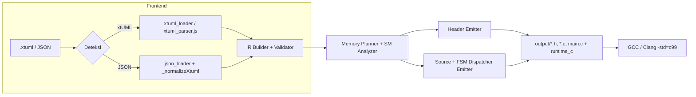
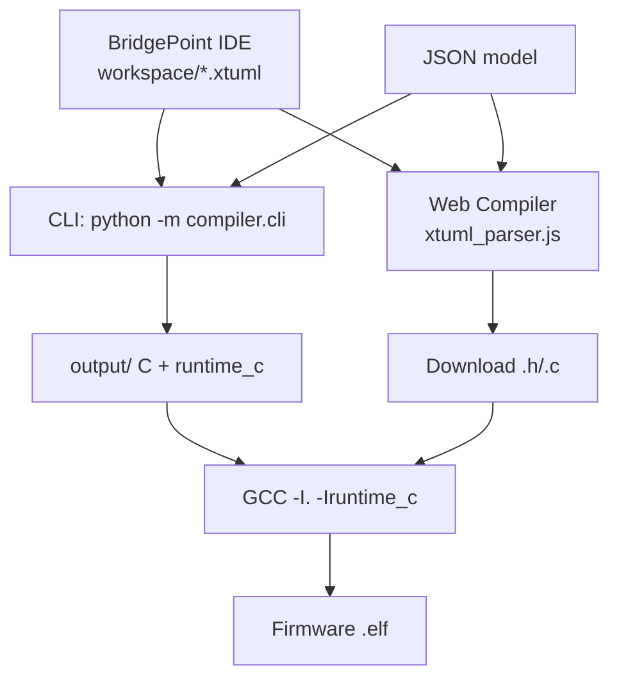

# UML-to-C Model Compiler

Compiler yang mentransformasikan model UML/xtUML menjadi kode C ISO C99 untuk sistem embedded. **Input tunggal-pipeline:** menerima **JSON native** maupun **.xtuml mentah BridgePoint** (file/folder/workspace) tanpa konversi manual — keduanya dinormalisasi ke IR yang sama lalu di-emit jadi C.

## Arsitektur Ringkas

```
.xtuml (BP 7.x) ─┬─ parser/xtuml_loader.py ─┐
                 │                          ├─ IR (metamodel.py/ir_builder.py) ─┬─ class_gen / fsm_gen / rel_gen ─> C (*.h/*.c)
JSON (native /   ├─ web/xtuml_parser.js ────┘                                 └─ main + runtime_c bundle
 xtUML VM env) ──┴─ parser/json_loader.py ─────────────────────────────────────┘
```

*Single source of truth*: `compiler/` untuk CLI, `web/` untuk browser berbagi logika parse yang sama (Python vs JS port). `tools/xtuml_import.py` hanya wrapper kompatibilitas.

## Struktur

```
uml-to-c-compiler/
├── compiler/              # inti compiler (Python, stdlib only)
│   ├── parser/
│   │   ├── json_loader.py      # JSON native + xtUML VM envelope normalizer
│   │   ├── xtuml_loader.py     # parser .xtuml mentah -> dict native
│   │   └── oal_parser.py       # subset OAL
│   ├── ir/                     # metamodel + ir_builder + validator
│   ├── codegen/                # c_writer / class_gen / fsm_gen / rel_gen
│   └── cli.py                  # CLI terintegrasi (deteksi otomatis xtUML vs JSON)
├── web/                   # compiler di browser
│   ├── xtuml_parser.js    # port JS dari xtuml_loader.py
│   ├── compiler.js        # compile() deteksi xtUML sebelum JSON.parse
│   ├── app.js             # multi-file .xtuml upload, dynamic file selector
│   └── index.html
├── tools/xtuml_import.py  # wrapper -> xtuml_loader.xtuml_to_dict
├── runtime_c/             # uml_types.h / uml_pool.h / uml_event_queue.h / uml_port.h
├── examples/              # calculator.json, door_model.json, contoh_native.json
├── tests/                 # test_compiler.py
└── output/                # hasil generate (gitignored)
```

## Instalasi

```bash
# stdlib only, tanpa pip install
python -m compiler.cli --help
```

## Penggunaan

```bash
# JSON (tetap didukung)
python -m compiler.cli examples/door_model.json -o output -v


# xtUML ke file JSON
python tools/xtuml_import.py "C:\BridgePoint\workspace\pppl_project" -o examples\imported_model.json
python -m compiler.cli examples\imported_model.json -o output

Remove-Item output\*.c,  output\*.h,  output\*.exe # bersih sisa test lama jika mau


# xtUML mentah — file tunggal
python -m compiler.cli "C:\BridgePoint\workspace\pppl_project\models\pppl_project\drink\VendingMachine\VendingMachine.xtuml" -o output -v

# xtUML mentah — workspace / folder (semua .xtuml digabung)
python -m compiler.cli "C:\BridgePoint\workspace\pppl_project" -o output -v --dump-json imported.json

# Web
cd web && python -m http.server 8000
# buka http://localhost:8000 — paste .xtuml atau JSON, atau Open File pilih *.xtuml (multi-file)
```

## Pipeline Kompilasi



## Deployment



Gaya: **template-less string emitter**, enum `CLASS_STATE_*` / `CLASS_EVENT_*`, switch-dispatcher, pool statis (`s_instance`, bebas malloc), kompilasi lolos `-std=c99 -Wall`.

## Model Format

JSON native:

```json
{
  "name": "ModelName",
  "classes": [{
    "name": "ClassName", "is_active": true,
    "attributes": [{"name": "id", "type": "int", "is_id": true}],
    "state_machine": {
      "events": [{"name": "evt", "id": 1}],
      "states": [{"name": "S1", "id": 0, "is_initial": true}],
      "transitions": [{"from": "S1", "to": "S2", "event": "evt"}]
    }
  }],
  "relationships": []
}
```

Envelope xtUML VM (`ref_xtuml_python/*.json`: `{sub_name, model:[{type:class}], events, relationships}`) dinormalisasi otomatis. `.xtuml` mentah (BP 7.x: `within ... is / class ... is / @state_num / transition ...`) di-parse regex stdlib menjadi format yang sama.

## Kode Hasil

Per class: `ClassName.h` (include guard, `UML_InstanceHeader_t`, enum State/Event, forward typedef `X_t*`, field `current_state`) dan `ClassName.c` (lifecycle `create/destroy`, `dispatch_event`, pool statis).

## OAL Subset

`create object instance`, `x.attr = val`, `generate EVT to target`, `if/else/while`, `delete object instance`, `relate/unrelate`, `select related`.

## Pengujian

```bash
python tests/test_compiler.py
# web smoke: node -e "global.window={}; eval(fs.readFileSync('web/xtuml_parser.js','utf8')); eval(fs.readFileSync('web/compiler.js','utf8')); new window.UMLToC().compile(fs.readFileSync('VendingMachine.xtuml','utf8'))"
```

## Runtime C

`uml_types.h` (int32_t/float/bool/uml_string_t, `UML_InstanceHeader_t`), `uml_pool.h` (static pool), `uml_event_queue.h` (ring buffer), `uml_port.h`. Tanpa heap.

## Keterbatasan

- OAL parser subset, bukan full BridgePoint OAL
- Relationship storage pointer sederhana, belum link-class generik
- FSM flat (tanpa hierarki/orthogonal), Pewarisan belum di-emit

## Referensi

- https://github.com/Alfianmnaa/xtUML-Compiler-to-Python
- https://github.com/AchmadAkif/pyxtuml
- https://xtuml.org / BridgePoint
