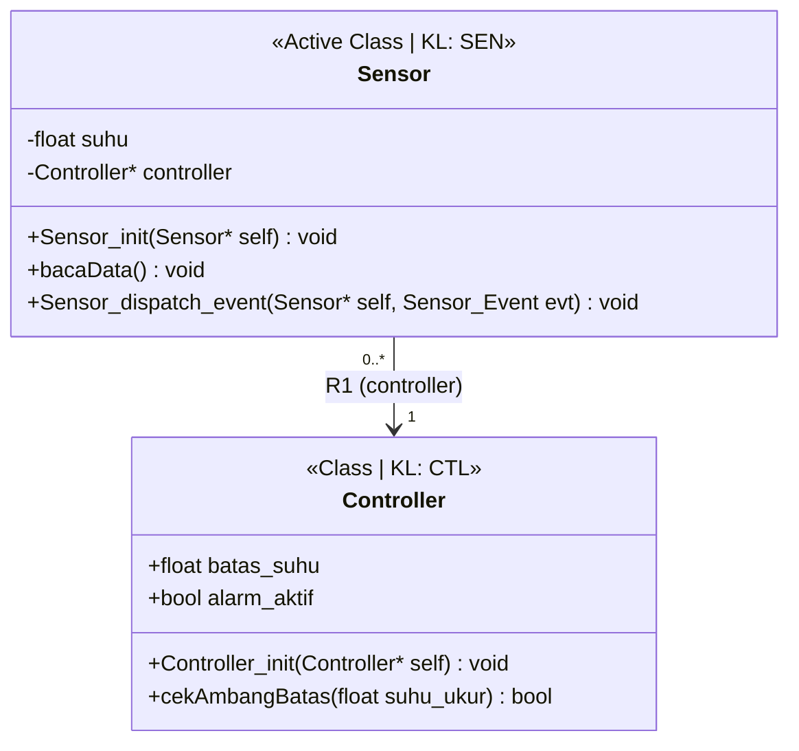

# Visual Verification Report: `SmartThermalMonitor` (xtUML 3-View IR)

## 1. xtUML Class Diagram



## 2. xtUML State Machine Diagram

```mermaid
stateDiagram-v2
    %% State Machine for Sensor (KL: SEN)
    [*] --> Sensor_Idle : Sensor_init(&self)
    state "@state_num(1) Sensor::Idle" as Sensor_Idle
    Sensor_Idle : entry /
    Sensor_Idle : self.suhu = 0.0f;
    state "@state_num(2) Sensor::Sampling" as Sensor_Sampling
    Sensor_Sampling : entry /
    Sensor_Sampling : self.bacaData();
    Sensor_Sampling : select one ctrl related by self->CTL[R1];
    Sensor_Sampling : if (not_empty ctrl)
    Sensor_Sampling : if (self.suhu > ctrl.batas_suhu)
    Sensor_Sampling : generate SEN3 :: Overheat() to self;
    Sensor_Sampling : end if;
    Sensor_Sampling : end if;
    state "@state_num(3) Sensor::OverheatAlert" as Sensor_OverheatAlert
    Sensor_OverheatAlert : entry /
    Sensor_OverheatAlert : select one ctrl related by self->CTL[R1];
    Sensor_OverheatAlert : if (not_empty ctrl)
    Sensor_OverheatAlert : ctrl.alarm_aktif = true;
    Sensor_OverheatAlert : end if;
    Sensor_Idle --> Sensor_Sampling : SEN1_StartSampling
    Sensor_Sampling --> Sensor_Idle : SEN2_SampleOK
    Sensor_Sampling --> Sensor_OverheatAlert : SEN3_Overheat
    Sensor_OverheatAlert --> Sensor_Idle : SEN4_Reset
```

## 3. xtUML Action Diagram (OAL Control-Flow Graph)

```mermaid
flowchart TD
    subgraph Controller_op_cekAmbangBatas["Action Diagram: Operation Controller::cekAmbangBatas()"]
        Controller_op_cekAmbangBatas_START(["START: Operation Controller::cekAmbangBatas()"])
        Controller_op_cekAmbangBatas_N1["OAL assign:\nself.alarm_aktif = (suhu_ukur > self.batas_suhu)"]
        Controller_op_cekAmbangBatas_START --> Controller_op_cekAmbangBatas_N1
        Controller_op_cekAmbangBatas_N2["OAL return:\nreturn self.alarm_aktif"]
        Controller_op_cekAmbangBatas_N1 --> Controller_op_cekAmbangBatas_N2
        Controller_op_cekAmbangBatas_END(["END"])
        Controller_op_cekAmbangBatas_N2 --> Controller_op_cekAmbangBatas_END
    end
    subgraph Sensor_op_bacaData["Action Diagram: Operation Sensor::bacaData()"]
        Sensor_op_bacaData_START(["START: Operation Sensor::bacaData()"])
        Sensor_op_bacaData_N1["OAL assign:\nself.suhu = 27.5f"]
        Sensor_op_bacaData_START --> Sensor_op_bacaData_N1
        Sensor_op_bacaData_END(["END"])
        Sensor_op_bacaData_N1 --> Sensor_op_bacaData_END
    end
    subgraph Sensor_state_Idle["Action Diagram: State @state_num(1) Sensor::Idle (Entry OAL)"]
        Sensor_state_Idle_START(["START: State @state_num(1) Sensor::Idle (Entry OAL)"])
        Sensor_state_Idle_N1["OAL assign:\nself.suhu = 0.0f"]
        Sensor_state_Idle_START --> Sensor_state_Idle_N1
        Sensor_state_Idle_END(["END"])
        Sensor_state_Idle_N1 --> Sensor_state_Idle_END
    end
    subgraph Sensor_state_Sampling["Action Diagram: State @state_num(2) Sensor::Sampling (Entry OAL)"]
        Sensor_state_Sampling_START(["START: State @state_num(2) Sensor::Sampling (Entry OAL)"])
        Sensor_state_Sampling_N1["OAL call:\nself.bacaData()"]
        Sensor_state_Sampling_START --> Sensor_state_Sampling_N1
        Sensor_state_Sampling_N2["OAL select_one:\nselect one ctrl related by self->CTL(R1)"]
        Sensor_state_Sampling_N1 --> Sensor_state_Sampling_N2
        Sensor_state_Sampling_N3{"OAL if:\nnot_empty ctrl"}
        Sensor_state_Sampling_N2 --> Sensor_state_Sampling_N3
        Sensor_state_Sampling_N4{"OAL if:\nself.suhu > ctrl.batas_suhu"}
        Sensor_state_Sampling_N3 -->|"True"| Sensor_state_Sampling_N4
        Sensor_state_Sampling_N5["OAL generate:\ngenerate SEN3:Overheat() to self"]
        Sensor_state_Sampling_N4 -->|"True"| Sensor_state_Sampling_N5
        Sensor_state_Sampling_END(["END"])
        Sensor_state_Sampling_N5 --> Sensor_state_Sampling_END
        Sensor_state_Sampling_N4 -->|"False"| Sensor_state_Sampling_END
        Sensor_state_Sampling_N3 -->|"False"| Sensor_state_Sampling_END
    end
    subgraph Sensor_state_OverheatAlert["Action Diagram: State @state_num(3) Sensor::OverheatAlert (Entry OAL)"]
        Sensor_state_OverheatAlert_START(["START: State @state_num(3) Sensor::OverheatAlert (Entry OAL)"])
        Sensor_state_OverheatAlert_N1["OAL select_one:\nselect one ctrl related by self->CTL(R1)"]
        Sensor_state_OverheatAlert_START --> Sensor_state_OverheatAlert_N1
        Sensor_state_OverheatAlert_N2{"OAL if:\nnot_empty ctrl"}
        Sensor_state_OverheatAlert_N1 --> Sensor_state_OverheatAlert_N2
        Sensor_state_OverheatAlert_N3["OAL assign:\nctrl.alarm_aktif = true"]
        Sensor_state_OverheatAlert_N2 -->|"True"| Sensor_state_OverheatAlert_N3
        Sensor_state_OverheatAlert_END(["END"])
        Sensor_state_OverheatAlert_N3 --> Sensor_state_OverheatAlert_END
        Sensor_state_OverheatAlert_N2 -->|"False"| Sensor_state_OverheatAlert_END
    end
```


